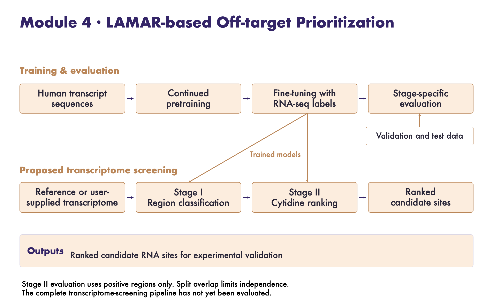
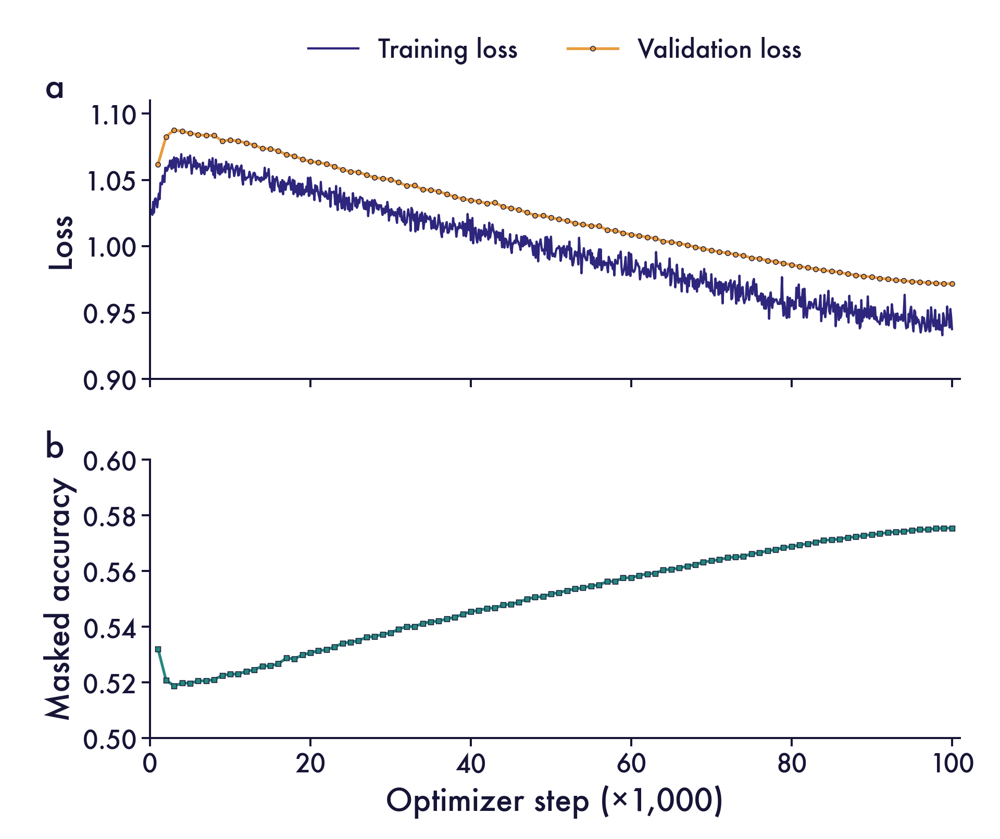
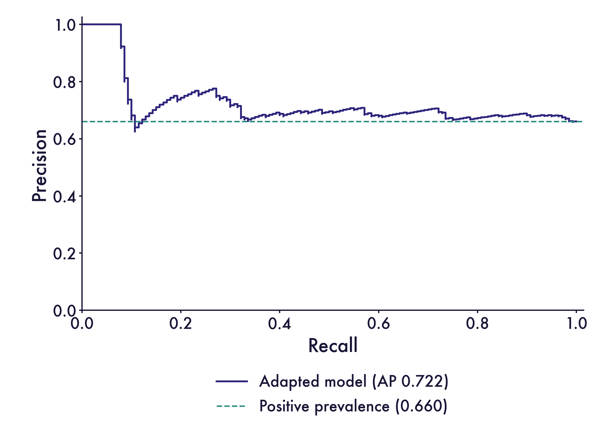
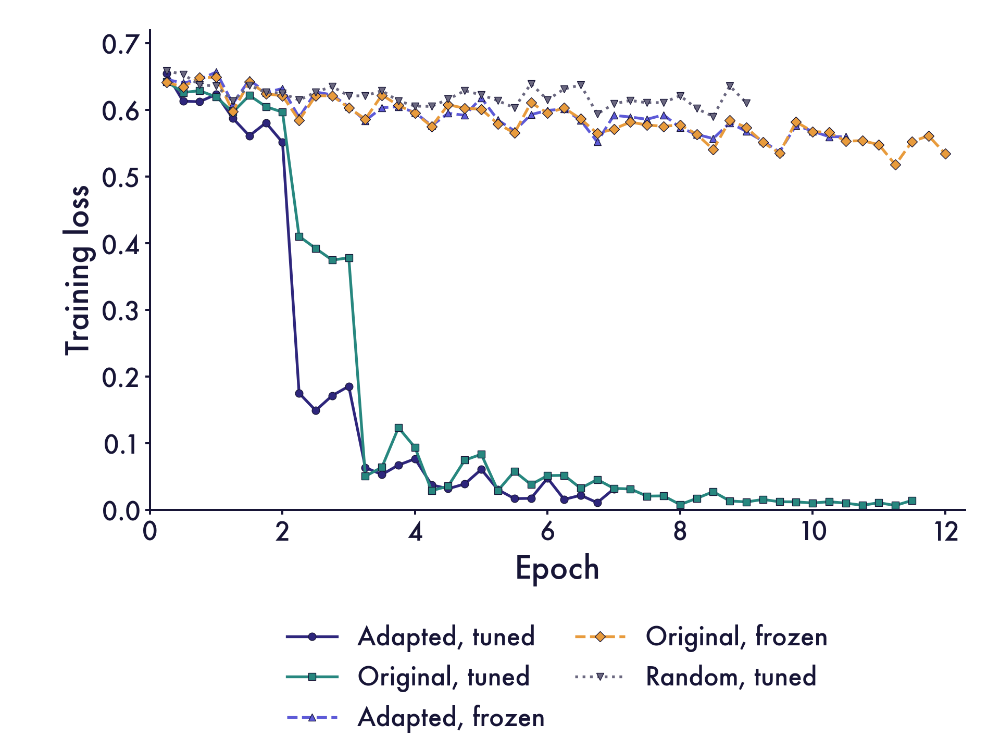
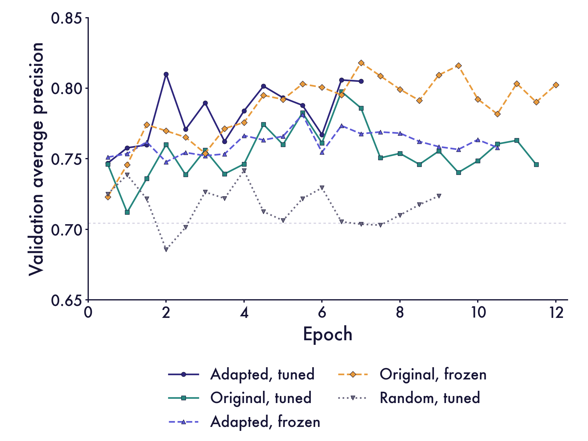
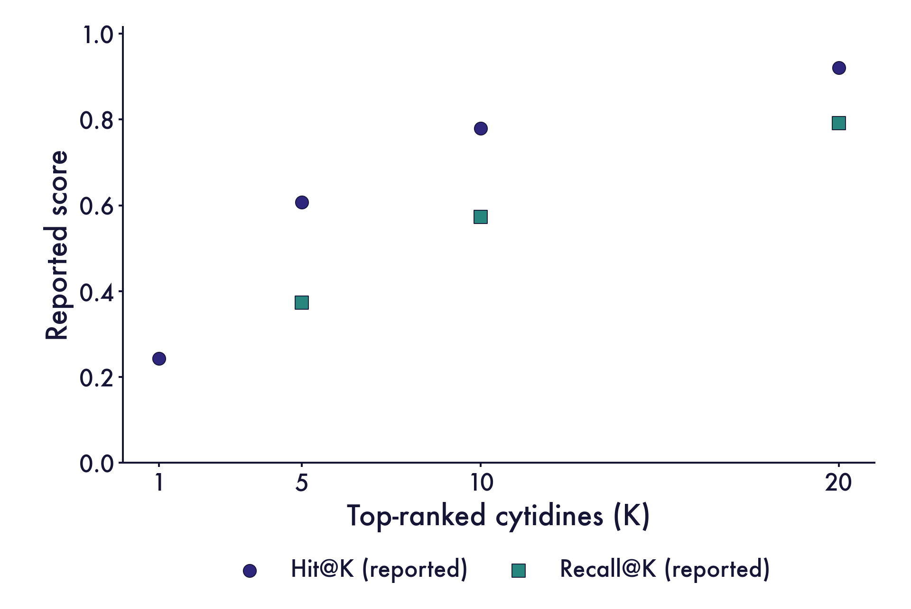

# Module 4 | LAMAR-guided prioritization of RNA editing candidates

## Background

Programmable RNA editing requires both useful target activity and control over editing elsewhere. Related PUF-guided editors illustrate how programmable targeting can coexist with off-target RNA editing. [Han et al., 2022](https://doi.org/10.1093/nar/gkac713). RNA sequencing (RNA-seq) reveals editing events under the conditions measured, but cannot exhaustively identify every susceptible cytidine. An undetected event may reflect low transcript abundance, limited coverage or low editing frequency.

Our dry-lab modules address complementary parts of this problem. RNA-seq analysis supplies editing evidence, while PUF and APOBEC modelling guide editor design. Module 4 asks whether RNA sequence representations can help prioritize candidate sites for subsequent experimental testing. We focused on the PUF12 dataset and separated regional screening from cytidine ranking.

We built the workflow around LAMAR, a Transformer-based RNA foundation model trained through masked nucleotide prediction. Its ability to support multiple RNA regulatory tasks provides a rationale for adapting sequence representations to editing-associated labels. [Zhou et al., 2025](https://doi.org/10.1186/s13059-025-03752-x).

## Model overview

**Workflow.** Continued pretraining and RNA-seq-labelled fine-tuning produce regional and cytidine-scoring models. The proposed application passes prioritized regions from Stage I to Stage II and nominates candidates for experimental validation. Evaluation currently addresses the individual stages; the complete screening pipeline remains unevaluated.

### RNA-seq evidence defines the prediction task

The upstream positive-site definition required at least **20 editing-supporting reads** and **100 total reads**. Cytidines without a positive label remain nominal negatives, rather than experimentally confirmed non-editable sites.

We organized prediction at two sequence scales. Stage I assigns a score to transcript regions of up to **1,024 nt**, including shorter terminal regions. A region is positive when it contains at least one labelled editing site. Stage II scores **101-nt cytidine-centred contexts** and ranks candidates within each region.

| Partition | Regions | Positive regions | Nominal negative regions |
|---|---:|---:|---:|
| Training | 3,835 | 2,643 | 1,192 |
| Validation | 213 | 150 | 63 |
| Test | 212 | 140 | 72 |

Region labels agree with the presence or absence of positive position-level labels. All positive position-level labels occur at cytidines. The evaluation unit is a sequence region; these counts do not represent verified unique transcripts.

### Human transcriptome adaptation and regional classification

Continued masked language modelling used human transcript sequences derived from GRCh38 and GENCODE release 50. This adaptation step learns sequence context without editing labels. GENCODE release 50 was published in June 2026. [Mudge et al., 2025](https://doi.org/10.1093/nar/gkae1078); [GENCODE release history](https://www.gencodegenes.org/human/releases.html).

The downstream encoder was configured with **12 layers, 768 hidden units, 12 attention heads and rotary positional embeddings**. Stage I adds a binary classification head. Hyperparameter selection used validation **average precision (AP)**, which summarizes precision as recall increases. AP was computed with `average_precision_score`; it is distinct from trapezoidal area under a precision–recall curve.

Stage I used a learning rate of **6.7068 × 10⁻⁵**, weight decay of **7.9194 × 10⁻⁶** and token dropout of **0.00552**. Training used batches of four, gradient accumulation of two and up to 15 epochs. Optuna selected hyperparameters using validation AP. [Akiba et al., 2019](https://doi.org/10.1145/3292500.3330701).

### Cytidine ranking matches a limited screening budget

Stage II extracts a 101-nt context around each candidate cytidine, using N padding at region boundaries. A scalar prediction head scores the central token representation. The multi-positive ranking loss compares the aggregate exponentiated score of labelled positives with that of all candidates in the region.

Training used a learning rate of **5 × 10⁻⁶**, weight decay of **0.01** and gradient accumulation of eight. The selected checkpoint was from epoch two, using validation Hit@10 as the selection metric. The output is a ranking score, not a calibrated editing probability.

**Hit@K** measures the fraction of regions with a labelled positive among their top K candidates. **Recall@K** averages the fraction of labelled positives recovered within each region. **Mean reciprocal rank (MRR)** uses the rank of the first labelled positive. Regions without positive candidates are excluded from these ranking summaries.

## Results

### Masked nucleotide reconstruction improved during continued pretraining

Masked nucleotide accuracy increased from **0.5321 at step 1,000** to **0.5755 at step 100,000** across 100 recorded evaluations. This measures reconstruction during adaptation; it does not directly assess editing prediction.

**Figure 1.** Continued-pretraining loss and masked nucleotide accuracy. Accuracy rises from 0.5321 at the first recorded evaluation to 0.5755 at step 100,000.

### Regional classification showed modest discrimination

The best Optuna trial reached validation AP **0.8134**, while the final model's validation AP was **0.8100**. On the 212-region test partition, AP was **0.7223** and ROC AUC was **0.5602**. Positive prevalence was **140/212 = 0.6604**, providing a reference for interpreting the precision–recall curve. [Saito & Rehmsmeier, 2015](https://doi.org/10.1371/journal.pone.0118432).

**Figure 2.** Stage I test precision–recall curve. AP is 0.7223, with a positive-prevalence reference of 0.6604.

### Adaptation did not consistently outperform the comparison conditions

We compared fine-tuned adapted LAMAR, fine-tuned original LAMAR, their encoder-frozen variants and a randomly initialized model.

**Figure 3.** Stage I training loss across five initialization and training conditions. The runs have different recorded training lengths.

**Figure 4.** Validation AP across the five conditions. Frozen original LAMAR reaches 0.8181, compared with 0.8100 in the adapted model's retained history.

The other recorded maxima were **0.7976** for original fine-tuning, **0.7813** for frozen adapted LAMAR and **0.7416** for random initialization. These single-run comparisons do not establish consistent superiority of continued pretraining. Reduced training loss alone is insufficient evidence of improved generalization.

### Cytidine ranking was evaluated within positive regions

The ranking evaluation considered **150 validation regions and 140 test regions** containing labelled positives. The project summary reported the following values.

| Metric | Validation | Test |
|---|---:|---:|
| Hit@1 | 0.247 | 0.243 |
| Hit@5 | 0.607 | 0.607 |
| Hit@10 | 0.847 | 0.779 |
| Hit@20 | 0.953 | 0.921 |
| Recall@5 | 0.381 | 0.373 |
| Recall@10 | 0.635 | 0.573 |
| Recall@20 | 0.841 | 0.792 |
| MRR | 0.409 | 0.406 |
| Median best rank | 4 | 4 |

**Figure 5.** Reported test ranking performance within positive regions. These summary values require independent reproduction because the underlying candidate scores are unavailable.

The reported test Hit@10 corresponds to at least one labelled site among the first ten candidates in **77.9%** of evaluated positive regions. Validation Hit@10 of **0.8467** is also recorded in checkpoint metadata. The remaining summaries lack candidate-score outputs for verification, so they provide provisional evidence for prioritization. They do not measure recovery after a Stage I selection threshold.

## Discussion

Regional scoring and cytidine ranking address different experimental questions. Regional AP exceeded the test prevalence reference, whereas conditional ranking assessed how early labelled sites appeared within positive regions. Neither result establishes calibrated editing probabilities, transcriptome-wide specificity or the performance of the complete two-stage pipeline.

Evaluation independence is also limited. Training shares one complete region sequence with validation and two with test, alongside extensive overlap in 101-nt contexts. Transcript-disjoint generalization therefore remains unestablished. Future evaluation should group related sequences before splitting and assess performance on newly collected data. [Joeres et al., 2025](https://doi.org/10.1038/s41467-025-58606-8).

A preprocessing inconsistency also limits reproducibility: Stage I tokenization specifies 103 tokens, whereas training and evaluation specify 1,026. The effective context length of the historical training run remains unresolved. This must be reconciled before attributing performance to long-range sequence information.

The next experimental step is to test high-ranked candidates alongside suitable low-ranked controls under defined editor and cell conditions. Measuring both outcomes would improve positive and negative evidence. A locked regional selection rule and ranking budget would allow evaluation of end-to-end recovery and experimental precision.

## Conclusion

Module 4 develops a sequence-based route from RNA-seq evidence to candidate prioritization. The current results define a testable workflow and its limitations, while prospective experiments remain necessary to establish its practical value.

## Data and code availability

Datasets, analysis code, model-training records, figure sources and reproducibility notes are available in the original [Module 4 GitHub repository](https://github.com/pdx12320/igem_module4). The [DBTL record](DBTL.md) describes the engineering decisions and next iteration. LAMAR is available from its [original source repository](https://github.com/rnasys/LAMAR).

## References

1. Han, W. et al. (2022). Programmable RNA base editing with a single gRNA-free enzyme. *Nucleic Acids Research*, 50, 9580–9595. [Article](https://doi.org/10.1093/nar/gkac713).
2. Zhou, H. et al. (2025). A foundation language model to decipher diverse regulation of RNAs. *Genome Biology*, 26, 301. [Article](https://doi.org/10.1186/s13059-025-03752-x).
3. Mudge, J. M. et al. (2025). GENCODE 2025: reference gene annotation for human and mouse. *Nucleic Acids Research*, 53, D966–D975. [Article](https://doi.org/10.1093/nar/gkae1078).
4. GENCODE (2026). Human release 50, June 2026. [Human release history](https://www.gencodegenes.org/human/releases.html).
5. Akiba, T. et al. (2019). Optuna: A next-generation hyperparameter optimization framework. *Proceedings of KDD*, 2623–2631. [Article](https://doi.org/10.1145/3292500.3330701).
6. Saito, T. & Rehmsmeier, M. (2015). The precision-recall plot is more informative than the ROC plot when evaluating binary classifiers on imbalanced datasets. *PLOS ONE*, 10, e0118432. [Article](https://doi.org/10.1371/journal.pone.0118432).
7. Joeres, R., Blumenthal, D. B. & Kalinina, O. V. (2025). Data splitting to avoid information leakage with DataSAIL. *Nature Communications*, 16, 3337. [Article](https://doi.org/10.1038/s41467-025-58606-8).
