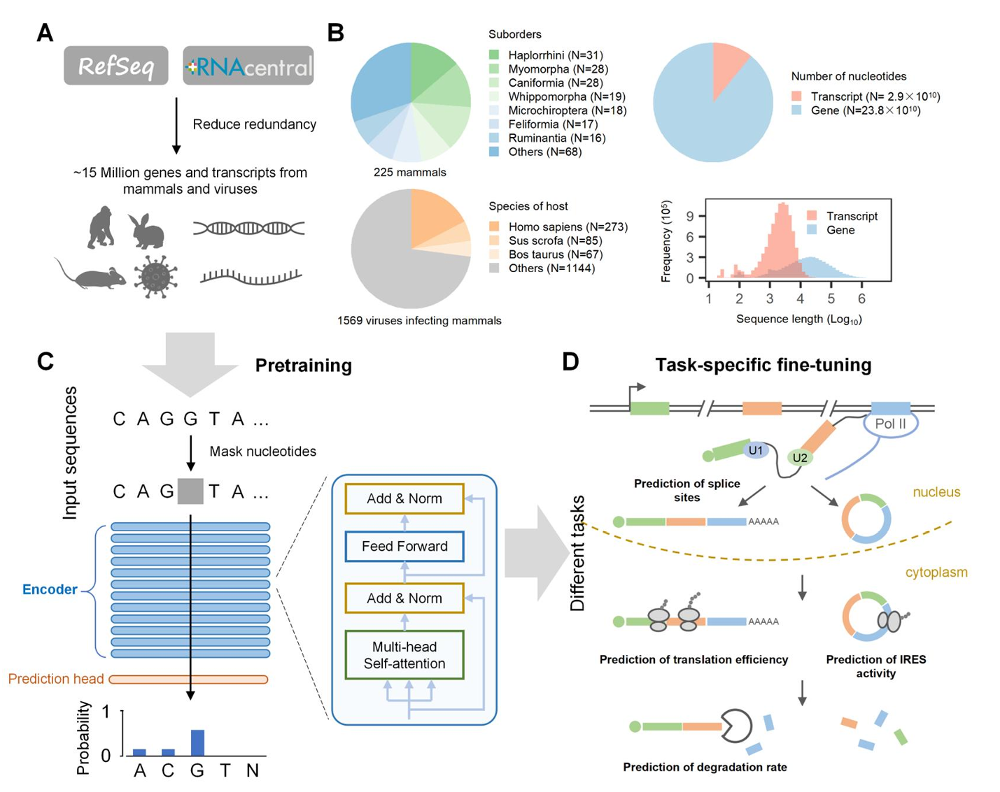
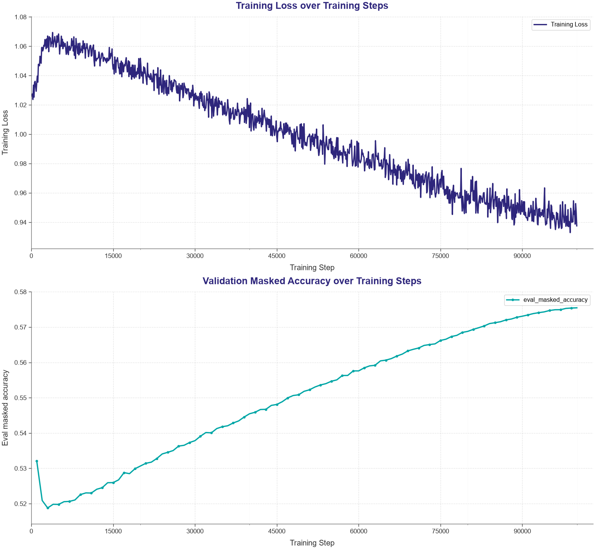
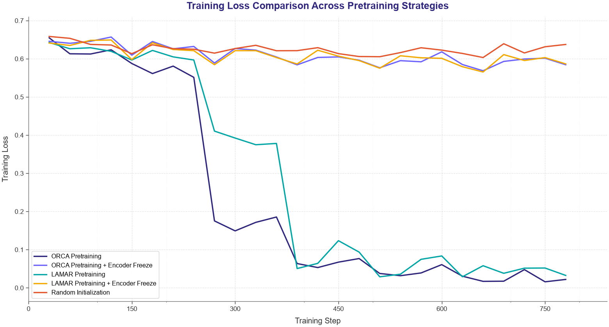
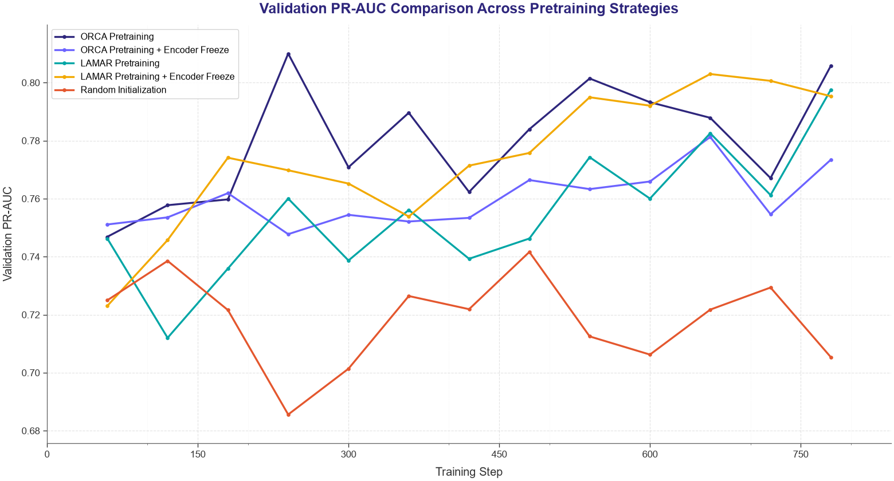
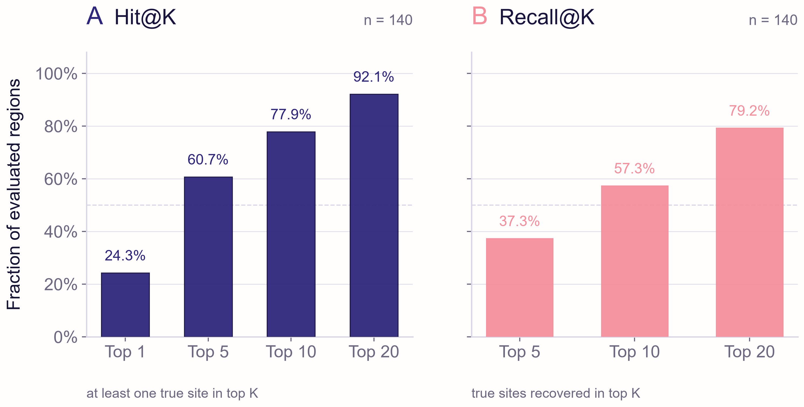
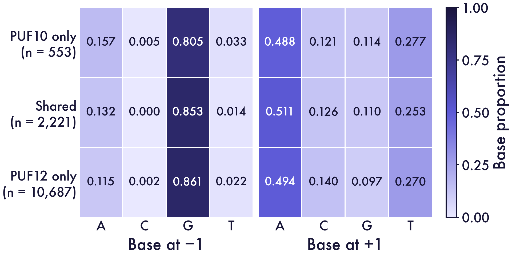
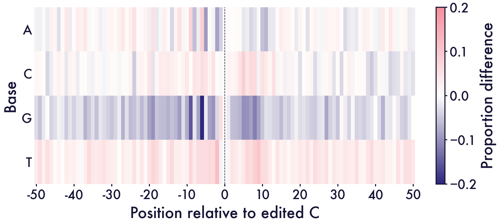

# Module 4: LAMAR Prioritization

<a id="module4-1"></a>

## 4.1 Overview

The LAMAR rankings placed a supported editing site among the first ten cytidines in 77.9% of 140 positive test windows. This result connects RNA-seq evidence to a practical shortlist for targeted follow-up.

We developed a LAMAR-based computational workflow to prioritize potential off-target C-to-U editing sites generated by our PUF-LIKER-APOBEC RNA editing system. The workflow integrates RNA-seq-derived editing evidence, human-transcriptome adaptation of an RNA foundation model and a two-stage prediction strategy.

Our design contribution is a **two-stage assessment** that separates the choice of candidate RNA regions from the ranking of cytidines within each region. **Stage I assesses transcript regions:** a region-level model asks whether a transcript segment is likely to contain an RNA-seq-supported editing site. This first assessment identifies regions that merit closer examination and organizes the broad transcriptome profile into candidate areas for follow-up.

**Stage II ranks cytidines within a region:** a site-level model compares individual cytidines using their local RNA sequence contexts and produces an ordered shortlist. The two stages therefore address successive decisions: which RNA regions deserve attention, and which cytidines within those regions should be measured first. This hierarchy connects transcriptome-wide evidence to a practical site-screening budget.

We developed this strategy after direct transcriptome-wide cytidine classification performed poorly. Editing-supported positives are sparse, and an undetected cytidine is not necessarily a confirmed negative. Separating regional assessment from within-region ranking makes these data limitations explicit while organizing the prediction task around focused follow-up. LAMAR provides the pretrained RNA representation; our contribution is its human-transcript adaptation and the design and evaluation of this prioritization workflow.

<a id="module4-2"></a>

## 4.2 Model and training data

### LAMAR foundation model

LAMAR is a Transformer-based RNA foundation model designed to learn regulatory information directly from RNA sequences. It uses a bidirectional Transformer encoder architecture related to ESM-style language models. The model contains 12 Transformer layers, 12 self-attention heads, a hidden dimension of 768 and rotary positional embeddings.

Self-attention lets the representation of a nucleotide depend on other positions in the input, following the Transformer framework (Vaswani et al., 2017). Rotary position embeddings encode positional relationships within that attention calculation (Su et al., 2021). Together, these components let LAMAR represent a cytidine in its surrounding sequence context rather than as an isolated base.

LAMAR uses single-nucleotide tokenization with the vocabulary `{A, T, C, G, N}` together with special tokens including `<cls>`, `<eos>`, `<mask>` and `<pad>`. The LAMAR-2k configuration supports contexts up to 2,048 nucleotides, making it suitable for transcript-region prediction.

The original model was pretrained with masked language modeling on approximately 15 million RNA sequences from 225 mammalian species and 1,569 mammal-infecting viral species. The pretraining corpus included mRNAs, non-coding RNAs and annotated genes from RefSeq and RNAcentral. After clustering at 80% sequence identity, the corpus contained approximately 267 billion nucleotide tokens.

RefSeq supplies annotated reference sequences, and RNAcentral integrates non-coding RNA sequences from specialist databases. Our human-transcript adaptation uses GENCODE sequences.

LAMAR has previously been fine-tuned for multiple RNA regulatory tasks, including splice-site prediction, translation-efficiency prediction, RNA stability prediction and internal ribosome entry site activity prediction. We selected LAMAR because its pretrained sequence representations could be adapted to the human transcriptome and then applied to APOBEC-associated RNA editing prediction.

The foundation model and its pretraining procedure were developed by Zhou et al. (2025). Our contribution here is its **adaptation to human transcripts and the construction and evaluation of an editing-site prioritization workflow**.

<a id="model-figure-33"></a>



**Figure 33.** LAMAR pretraining and masked nucleotide prediction. Adapted from Zhou et al. (2025).

<a id="module4-labels"></a>

### RNA-seq-derived training labels

We constructed high-confidence positive labels from RNA-seq candidate sites generated for the PUF-LIKER-APOBEC editing system.

The positive-label definition used two read-support criteria:

- Editing-supporting reads: at least 20
- Total sequencing depth: at least 100

These criteria define detected positive sites under the experimental conditions; other cytidines remain unlabeled (Elkan and Noto, 2008).

All sequences were represented in transcript orientation. Because the editor performs C-to-U editing, cytidines were used as the candidate nucleotides for cytidine-level prediction.

<a id="module4-adaptation"></a>

### Human transcriptome continued pretraining

#### Rationale

LAMAR was pretrained across many mammalian and viral species. We continued unsupervised pretraining on human transcripts before editing-site prediction, following the rationale of domain-adaptive pretraining (Gururangan et al., 2020).

Transcript annotations came from GENCODE human release 50, and sequence extraction used GffRead (Pertea and Pertea, 2020).

The GENCODE annotation framework is described by Mudge et al. (2025); release 50 provides the human reference used here.

The transcriptome FASTA file was generated with `gffread` using:

| Input | Source |
| --- | --- |
| Gene annotation | `gencode.v50.chr_patch_hapl_scaff.annotation.gtf` |
| Genome sequence | `GRCh38.primary_assembly.genome.fa` |
| Generated transcriptome | `gencode.v50.transcripts.fa` |

The human transcriptome resource comprised:

| Property | Value |
| --- | --- |
| Transcript sequences | 644,292 |
| Total nucleotides | 1,443,754,799 |

#### Continued pretraining strategy

Starting from the original LAMAR checkpoint, we continued masked language modeling on the human transcriptome. The model reconstructs masked nucleotides from their surrounding sequence context (Devlin et al., 2019).

For example:

```
Input:      AUGCUA[MASK]GGUA

Prediction: AUGCUAACGGUA
```

#### Continued pretraining result

Masked nucleotide prediction accuracies on human transcripts were:

| Model | Masked prediction accuracy on human transcript sequences |
| --- | --- |
| Original LAMAR | 0.505 |
| Human-adapted LAMAR | 0.575 |

Human-transcript adaptation reached a final masked prediction accuracy of 0.575, compared with the original-model baseline of 0.505.

Masked nucleotide prediction measures sequence reconstruction. Supervised editing-site training then uses RNA-seq labels to learn the region and cytidine scores evaluated below.

<a id="model-figure-34"></a>



**Figure 34.** Training loss and masked nucleotide accuracy during continued LAMAR pretraining on human transcripts.

<a id="module4-strategy"></a>

## 4.3 Two-stage prediction

### Initial strategy: direct cytidine-level classification

Our first design treated experimentally observed editing sites as positive examples and other transcriptomic cytidines as negative examples.

The intended task was:

```
Input:  101-nt RNA sequence centered on a cytidine

Output: Edited / not edited
```

Direct nucleotide-level classification performed poorly. Two properties of the training labels motivated the redesign.

#### Severe class imbalance

Experimentally observed editing sites were rare compared with all cytidines in the transcriptome. The training data therefore contained far more nominal negative examples than positive examples.

Precision–recall evaluation makes recovery of positive sites explicit, and its interpretation depends on the proportion of positives in the evaluated data (Saito and Rehmsmeier, 2015). We therefore report region-level and cytidine-level performance separately.

#### Detection-dependent labels

Detection depends on sequencing depth, transcript abundance, editing frequency and experimental conditions. The observed positive set therefore represents the sites supported under those conditions.

These label properties motivated a shift from transcriptome-wide binary classification to candidate prioritization at two resolutions.

### Stage I: 1024-nt candidate-region classifier

The first model identifies transcript regions that are more likely to contain at least one editing site.

The study design specified 1,024-nt windows with a 128-nt overlap. The evaluated dataset also contained shorter regions.

A window was labeled positive when it contained at least one high-confidence editing site. A window containing no detected editing site was labeled negative.

The evaluation used fixed training, validation and test partitions of sequence–label records.

One full region sequence was shared between training and validation, and two between training and test. The metrics below describe performance within these partitions.

Sequence relatedness is an important part of evaluation design (Kapoor and Narayanan, 2023). Independent transcript-level partitions form the basis of future transfer assessments.

| Split | Total windows | Positive windows | Negative windows |
| --- | --- | --- | --- |
| Training | 3,835 | 2,643 | 1,192 |
| Validation | 213 | 150 | 63 |
| Test | 212 | 140 | 72 |

The split ratio was approximately 90% training, 5% validation and 5% test data.

The Stage I task was formulated as:

```
Input:  1,024-nt transcript sequence window

Output: Probability that the window contains at least one RNA-seq-supported editing site
```

### Stage II: 101-nt cytidine-centered ranking

Stage II assigns a scalar editing-associated score to the central cytidine in a 101-nt sequence context.

```
Output: Editing-associated score
```

The application combines Stage I region selection with Stage II cytidine ranking. Stage II used each positive window as one ranking-evaluation unit. Cytidines were ranked within each window, using a 101-nt context for each cytidine.

Ranking these scores turns a selected region into **an ordered list of sites that can be measured within an available screening budget**.

<a id="module4-training"></a>

### Model training

Stage I uses a LAMAR encoder with a binary-classification head and an Optuna search. Stage II uses a scalar ranking head with fixed training settings.

Optuna supports the Stage I parameter search (Akiba et al., 2019). The tables summarize the model design and optimization configurations.

The classifier architecture is summarized below. Its two output labels belong to the classifier design; the Stage II ranking head has a scalar output.

| Parameter | Value |
| --- | --- |
| Hidden size | 768 |
| Intermediate size | 3,072 |
| Attention heads | 12 |
| Transformer layers | 12 |
| Positional embedding | Rotary positional embedding |
| Output labels | 2 |
| Classification head | Linear |
| Maximum sequence length, Stage I | 1,026 tokens including special tokens |
| Random seed | 42 |

#### Stage I optimization

The Stage I design specified up to 15 epochs, early stopping with patience 10 and selection by validation PR-AUC.

| Hyperparameter | Selected value |
| --- | --- |
| Batch size per device | 4 |
| Gradient accumulation steps | 2 |
| Effective batch configuration | batch4_accum2 |
| Learning rate | 5e-4 |
| Weight decay | 7.9194e-6 |
| Token dropout | 0.0 |
| Warmup ratio | 0.05338 |
| Maximum epochs | 15 |

#### Stage II optimization

The ranking implementation uses fixed settings and validation Hit@10 for model selection.

| Hyperparameter | Selected value |
| --- | --- |
| Optuna trial | 10 |
| Batch configuration | batch4_accum2 |
| Learning rate | 1.0139e-5 |
| Weight decay | 6.6122e-5 |
| Token dropout | 8.9809e-4 |
| Warmup ratio | 0.09762 |

<a id="module4-3"></a>

## 4.4 Results

### Stage I results: candidate-region enrichment

Stage I reached a best search validation score of 0.813, a final validation score of 0.810 and a test score of 0.722. PR-AUC here denotes average precision (AP).

The test set comprised 212 transcript windows, including 140 positive windows (66.0%).

| Dataset | Best PR-AUC |
| --- | --- |
| Validation | 0.813 |
| Test | 0.722 |

<a id="model-figure-35"></a>





**Figure 35.** Stage I training loss and validation PR-AUC across continued-pretrained, original, encoder-frozen and randomly initialized LAMAR configurations.

The continued-pretrained and original LAMAR models showed lower training losses than the encoder-frozen and randomly initialized configurations.

Original LAMAR with a frozen encoder reached the highest validation AP among the compared runs. Training loss and validation AP therefore capture different aspects of model performance.

<a id="module4-ranking"></a>

### Stage II results: cytidine ranking

The cytidine-level PR-AUC was approximately 0.2. Our practical objective is to rank a short list of sites for targeted follow-up.

Validation Hit@10 was 0.8467, rounded to 0.847 in the table.

#### Ranking metrics

For a given positive window:

- Hit@K indicates whether at least one true editing site was present among the top K highest-scoring cytidines.
- Recall@K indicates the fraction of true editing sites recovered among the top K cytidines.
- MRR is the mean reciprocal rank of the highest-ranked true editing site.
- Best rank is the rank of the highest-scoring true editing site within a window.

#### Validation results

The validation evaluation comprised 150 positive windows.

| Metric | Validation result |
| --- | --- |
| Hit@1 | 0.247 |
| Hit@5 | 0.607 |
| Hit@10 | 0.847 |
| Hit@20 | 0.953 |
| Recall@5 | 0.381 |
| Recall@10 | 0.635 |
| Recall@20 | 0.841 |
| MRR | 0.409 |
| Mean best rank | 6.527 |
| Median best rank | 4 |
| Evaluated positive windows | 150 |

#### Test results

The test evaluation comprised 140 positive windows under the same criterion.

| Metric | Test result |
| --- | --- |
| Hit@1 | 0.243 |
| Hit@5 | 0.607 |
| Hit@10 | 0.779 |
| Hit@20 | 0.921 |
| Recall@5 | 0.373 |
| Recall@10 | 0.573 |
| Recall@20 | 0.792 |
| MRR | 0.406 |
| Mean best rank | 7.429 |
| Median best rank | 4 |
| Evaluated positive windows | 140 |

In the test summary, the top 5 cytidines included a supported site in 60.7% of positive windows. This increased to 77.9% for the top 10 and 92.1% for the top 20.

The median best rank was 4: in the median evaluated window, the highest-ranked supported site appeared fourth.

Hit@10 directly translates the ranking into a ten-site screening budget.

<a id="model-figure-36"></a>



**Figure 36.** Reported Hit@K and Recall@K for 140 positive test windows. Hit@K indicates any supported site within the top K; Recall@K is the fraction of supported sites recovered within the top K.

<a id="module4-4"></a>

## 4.5 Interpretation and next steps

Stage I evaluates candidate transcript regions, reaching test AP of 0.722 in the regional cohort.

The top 10 and top 20 lists included a supported site in 77.9% and 92.1% of positive test windows. These results define two practical screening budgets.

<a id="module4-implications"></a>

### Engineering implications

LAMAR provides a candidate-ranking system for selecting RNA sites under a defined cell type, editor and treatment condition.

The current input describes RNA sequence. Incorporating PUF and APOBEC identities would extend that representation to editor-specific ranking.

Expanding the list from ten to twenty improves recovery while increasing the number of measurements. These metrics make the screening budget an explicit design choice.

<a id="module4-5"></a>

### Future work

Future applications include additional cell lines, species and disease-relevant models.

- evaluating editor-specific models for different PUF and APOBEC variants;
- integrating transcript abundance, local RNA secondary structure and accessibility features.


### RNA context connects editing profiles to site prioritization


The regional rankings and local sequence profiles provide complementary views of the editing substrate. LAMAR orders cytidines for follow-up, while the RNA-seq comparisons describe the contexts of detected sites.


<a id="module4-context-composition"></a>

### Shared central contexts accompany distinct flanking profiles


The PUF10-only, shared and PUF12-only sets contained 553, 2,221 and 10,687 selected sites. GCA was the most common central triplet in all three sets, at 39.78%, 43.40% and 41.82%, respectively. These compositions extend the per-editor logos in Figure 6 by distinguishing shared sites from those selected for one editor.


<a id="model-figure-37"></a>





**Figure 37.** Base proportions at −1 and +1 around edited C in PUF10-only (553), shared (2,221) and PUF12-only (10,687) retained-site sets.


Across the 101-nt windows, the largest observed base-proportion difference was G at position −6. Its frequency was 19.78 percentage points lower in PUF12-only sites than in PUF10-only sites. The flanking profiles therefore add positional detail to the shared central GCA pattern.


<a id="model-figure-38"></a>





**Figure 38.** Base-proportion differences, PUF12-only minus PUF10-only, across 101 positions centred on edited C. Indigo is negative; coral is positive.


### Connecting the four modeling decisions


RNA-seq defines the detected editing profile, PUF modeling ranks recognition-domain variants, and APOBEC engineering evaluates catalytic preference and retained activity. LAMAR adds a site-selection step by ranking RNA contexts. Together, these modules connect editor selection with the choice of RNA sites to measure.


A coordinated follow-up can compare combined PUF–APOBEC variants with their matched parents and measure high- and low-ranked RNA sites. This connects local reporter performance to transcriptome-wide profiles under the same editor conditions.

<a id="module4-6"></a>

## 4.6 Reproducibility and availability

The Module 4 repository contains archived datasets, training histories, model-selection records, Stage I predictions, checkpoint metadata and plotting code. Readers can inspect these records, run lightweight repository checks and regenerate figures from saved outputs. Provenance records distinguish recalculated summaries from draft-reported rankings. Full model reruns require external weights, reference corpora and reconstruction of the recorded runtime environment. Site-level Stage II ranking outputs are not included, so those ranking summaries cannot be recomputed from the repository alone.

- [Module 4 GitHub repository](https://github.com/pdx12320/igem_module4)

<a id="module4-7"></a>

## 4.7 References

1. Zhou, H. et al. (2025). A foundation language model to decipher diverse regulation of RNAs. *Genome Biology*, 26, 301. doi:10.1186/s13059-025-03752-x.
2. GENCODE. (2026). GENCODE human release 50, GRCh38.p14. Release 50 annotation and files. Released June 2026; annotation freeze May 2025, as recorded in the release history.
3. Pertea, G., &amp; Pertea, M. (2020). GFF Utilities: GffRead and GffCompare. *F1000Research*, 9, 304. doi:10.12688/f1000research.23297.2.
4. Akiba, T., Sano, S., Yanase, T., Ohta, T., &amp; Koyama, M. (2019). Optuna: A Next-generation Hyperparameter Optimization Framework. *Proceedings of the 25th ACM SIGKDD International Conference on Knowledge Discovery &amp; Data Mining*, 2623–2631. doi:10.1145/3292500.3330701; author manuscript.
5. Saito, T., &amp; Rehmsmeier, M. (2015). The Precision-Recall Plot Is More Informative than the ROC Plot When Evaluating Binary Classifiers on Imbalanced Datasets. *PLOS ONE*, 10(3), e0118432. doi:10.1371/journal.pone.0118432.
6. Vaswani, A. et al. (2017). Attention Is All You Need. *arXiv*, 1706.03762. doi:10.48550/arXiv.1706.03762.
7. Su, J., Lu, Y., Pan, S., Murtadha, A., Wen, B., &amp; Liu, Y. (2021). RoFormer: Enhanced Transformer with Rotary Position Embedding. *arXiv*, 2104.09864. doi:10.48550/arXiv.2104.09864.
8. Devlin, J., Chang, M.-W., Lee, K., &amp; Toutanova, K. (2019). BERT: Pre-training of Deep Bidirectional Transformers for Language Understanding. *Proceedings of NAACL-HLT*, 4171–4186. doi:10.18653/v1/N19-1423.
9. Gururangan, S. et al. (2020). Don’t Stop Pretraining: Adapt Language Models to Domains and Tasks. *Proceedings of the 58th Annual Meeting of the Association for Computational Linguistics*, 8342–8360. doi:10.18653/v1/2020.acl-main.740.
10. Mudge, J. M. et al. (2025). GENCODE 2025: reference gene annotation for human and mouse. *Nucleic Acids Research*, 53(D1), D966–D975. doi:10.1093/nar/gkae1078.
11. O’Leary, N. A. et al. (2016). Reference sequence (RefSeq) database at NCBI: current status, taxonomic expansion, and functional annotation. *Nucleic Acids Research*, 44(D1), D733–D745. doi:10.1093/nar/gkv1189.
12. RNAcentral Consortium. (2021). RNAcentral 2021: secondary structure integration, improved sequence search and new member databases. *Nucleic Acids Research*, 49(D1), D212–D220. doi:10.1093/nar/gkaa921.
13. Elkan, C., &amp; Noto, K. (2008). Learning classifiers from only positive and unlabeled data. *Proceedings of the 14th ACM SIGKDD International Conference on Knowledge Discovery and Data Mining*, 213–220. doi:10.1145/1401890.1401920.
14. Kapoor, S., &amp; Narayanan, A. (2023). Leakage and the reproducibility crisis in machine-learning-based science. *Patterns*, 4(9), 100804. doi:10.1016/j.patter.2023.100804.
